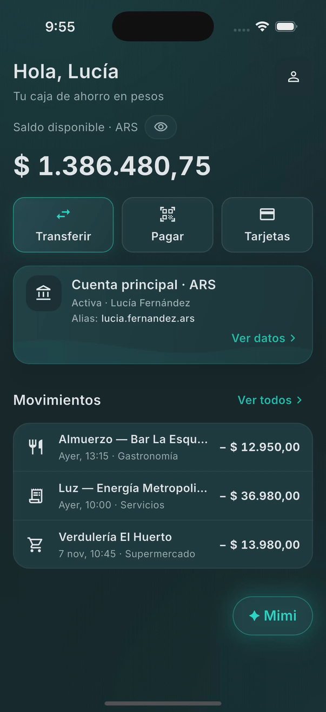
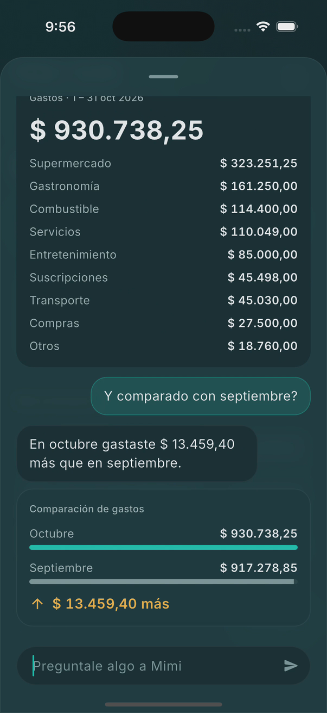
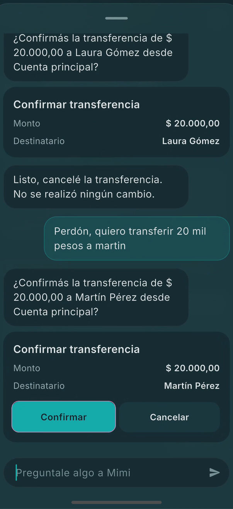
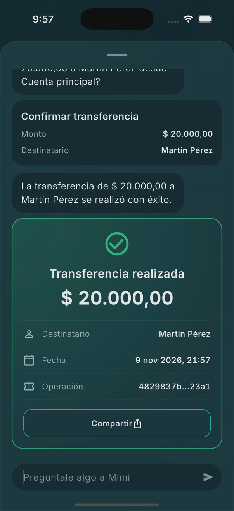
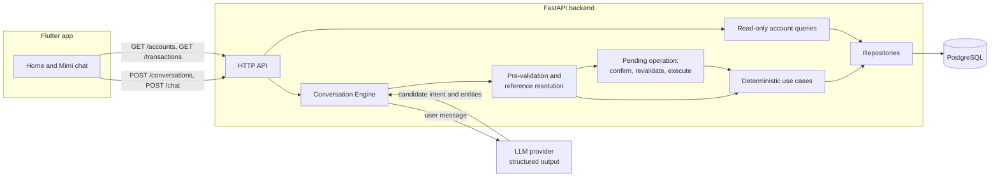

# Mimi — Banking Assistant

**AI understands. Banking stays deterministic.**

[](https://github.com/msecchu94/mimi-banking-assistant/actions/workflows/backend-ci.yml)
[](https://github.com/msecchu94/mimi-banking-assistant/actions/workflows/mobile-ci.yml)
[](LICENSE)

Mimi is a conversational banking assistant built with Flutter and FastAPI.
Users ask in natural language — *"¿Cuánto gasté en octubre?"*, *"¿Y comparado
con septiembre?"*, *"Quiero transferir a Laura"* — and get answers grounded in
persisted account data.

The design splits the work in two:

- **An LLM interprets.** Each free-text message is sent to the model, which
  returns a structured, schema-validated *candidate* interpretation: one of a
  fixed set of intents plus entities such as a period, category, card,
  beneficiary or amount.
- **The backend decides and executes.** Deterministic use cases validate that
  candidate, resolve references against the database, compute every figure,
  and run state-changing operations only after explicit, parameter-bound
  confirmation. Every reply shown to the user is composed by backend code from
  those results; the model never writes user-facing text.

Mimi is a portfolio project: the data is synthetic and transfers are
simulated. It is not an autonomous agent and does not use LLM tool calling.

## Demo

<table>
  <tr>
    <td align="center"></td>
    <td align="center"></td>
    <td align="center"></td>
    <td align="center"></td>
  </tr>
  <tr>
    <td align="center"><sub>Home</sub></td>
    <td align="center"><sub>Spending analysis</sub></td>
    <td align="center"><sub>Transfer confirmation</sub></td>
    <td align="center"><sub>Transfer receipt</sub></td>
  </tr>
</table>

<!-- PLACEHOLDER: replace with the public URL of the full demo video once it is published. -->
**Full demo video (1 min 39 s):** *link coming soon*

The app UI is in Spanish (Argentina). Screenshots are taken from the demo
recording on the iOS Simulator.

## Key features

**Released in [v1.0.0](https://github.com/msecchu94/mimi-banking-assistant/releases/tag/v1.0.0)**

- Account balances in ARS and USD.
- Transaction queries filtered by period, category and transaction type.
- Spending analysis by category and period-to-period comparison, computed by
  the backend.
- Card listing, plus freezing and unfreezing a card with explicit confirmation.
- Simulated transfers to saved beneficiaries: step-by-step data collection,
  confirmation, a receipt, and sharing it through the native share sheet.
- Follow-up questions within a conversation (*"¿Y comparado con
  septiembre?"*, *"Solo en supermercados"*) and cancelling an operation in
  progress.
- Confirm, cancel and card-selection actions handled without any LLM call.

**Added after v1.0.0 (on `main`)**

- The Home screen reads the balance and the three latest transactions from
  read-only backend endpoints (`GET /accounts`, `GET /transactions`), and
  reloads them as soon as Mimi reports a completed transfer.
- A demo-video rendering pipeline in [`video-editing/`](video-editing/).

## Architecture



**Backend** (`backend/src/mimi/`) follows a pragmatic Clean Architecture:

- `domain/`: framework-independent entities and enums.
- `application/`: use cases, the Conversation Engine, and the ports
  (repository and LLM interfaces) the application depends on.
- `infrastructure/`: SQLAlchemy repositories, migrations and the OpenAI
  provider, which uses the Responses API with a typed output schema.
- `api/`: FastAPI routers and the mapping from application results to the
  typed Chat API contract. HTTP concerns stop here.
- `composition.py`: the composition root, where concrete dependencies are
  wired explicitly.

**Mobile** (`mobile/lib/`) is feature-first Clean Architecture
(`features/<feature>/{domain,data,presentation}`), using Riverpod for state,
Dio for HTTP, and Freezed for immutable models. Use cases return explicit
success or failure results. Flutter renders the typed UI items the backend
returns; it does not reproduce banking or conversation logic.

## AI safety and deterministic execution

The rules are specified in [AI_SAFETY.md](docs/architecture/AI_SAFETY.md).
In short:

- **LLM output is untrusted.** It is parsed into a fixed schema; malformed or
  unsupported values are discarded and flagged rather than guessed.
- **The LLM has no financial authority.** It does not read balances, compute
  totals, change state or authorize operations. All figures come from
  persisted data through deterministic code.
- **State changes require explicit confirmation.** Freezing or unfreezing a
  card and transfers become a pending operation. Confirmation is bound to its
  exact parameters, and the operation is revalidated before it executes.
- **Structured interactions skip the LLM.** Confirm, cancel and card
  selection are typed interactions handled directly by the Conversation
  Engine.
- **Interpretation quality is measured.** A manually triggered workflow runs
  versioned interpretation datasets (`backend/evals/interpretation/`) against
  a configured model.

## Technology stack

| Layer | Technology |
|---|---|
| Mobile | Flutter 3.47, Dart 3.13, Riverpod 3, auto_route, Dio, Freezed, fpdart, share_plus |
| Backend | Python 3.12+, FastAPI, Pydantic Settings, SQLAlchemy 2, Alembic, psycopg 3 |
| Database | PostgreSQL 16 |
| LLM | OpenAI Responses API with structured output (provider behind an application port) |
| Quality | pytest, Ruff, mypy, flutter analyze, flutter test, GitHub Actions |

## Getting started

These steps run the backend locally and the app on the iOS Simulator (macOS).

### Prerequisites

- Python 3.12 or newer
- PostgreSQL 16, running locally
- Flutter 3.47 and Xcode with an iOS Simulator
- An OpenAI API key (the backend refuses to start without a model and a key)

### 1. Backend

```bash
git clone https://github.com/msecchu94/mimi-banking-assistant.git
cd mimi-banking-assistant/backend

python3 -m venv .venv
source .venv/bin/activate
pip install -e ".[dev]"

createdb mimi
cp .env.example .env
```

Edit `backend/.env` (it is git-ignored; never commit it):

```dotenv
MIMI_DATABASE_URL=postgresql+psycopg://<user>:<password>@localhost:5432/mimi
MIMI_LLM_MODEL=<an OpenAI model that supports structured outputs>
MIMI_LLM_API_KEY=<your API key>
```

The remaining values in `.env.example` (environment, timezone and the demo
customer ID) work as provided.

Create the schema, load the synthetic dataset, and start the API:

```bash
alembic upgrade head
python -m mimi.infrastructure.database.seed
uvicorn mimi.main:app --reload
```

The seed creates one customer, two accounts, three cards, five beneficiaries
and three months of transactions before today (or before
`--reference-date YYYY-MM-DD`). Add `--reset` to replace an existing demo
dataset. Seeding is refused in the production environment.

Check the server:

```bash
curl -s http://localhost:8000/health
# {"status":"ok"}
```

### 2. Mobile app (iOS Simulator)

In a second terminal, with the backend running:

```bash
cd mimi-banking-assistant/mobile
flutter pub get
open -a Simulator
flutter run --dart-define-from-file=config/development.json
```

`config/development.json` points the app at `http://localhost:8000`.
Generated code (`*.g.dart`, `*.freezed.dart`) is committed, so no
`build_runner` step is needed.

Tap **✦ Mimi** and try *"Muéstrame saldos de mis cuentas"*, *"¿Cuánto gasté
en octubre?"* followed by *"¿Y comparado con septiembre?"*, or *"Quiero
transferir a Laura"*.

More detail and troubleshooting:
[API_USAGE.md](docs/api/API_USAGE.md) and
[LOCAL_DEVELOPMENT.md](docs/development/LOCAL_DEVELOPMENT.md) (in Spanish).

## Testing and GitHub Actions

| Workflow | Trigger | Runs |
|---|---|---|
| [Backend CI](.github/workflows/backend-ci.yml) | PRs and pushes to `main` touching `backend/` | `ruff format --check`, `ruff check`, `mypy`, `pytest` against a PostgreSQL 16 service |
| [Mobile CI](.github/workflows/mobile-ci.yml) | PRs and pushes to `main` touching `mobile/` | `dart format` check, `flutter analyze`, `flutter test` |
| [LLM Evaluation](.github/workflows/llm-evaluation.yml) | Manual | Interpretation dataset against a chosen model (uses the API key secret) |

Run the same checks locally:

```bash
# backend/ (PostgreSQL integration tests run when MIMI_TEST_DATABASE_URL is set)
ruff format --check . && ruff check . && mypy && pytest

# mobile/
dart format --output=none --set-exit-if-changed lib test integration_test
flutter analyze && flutter test
```

The app's launch test in `mobile/integration_test/` needs a simulator or
device, so it is not part of CI:
`flutter test integration_test --dart-define-from-file=config/development.json`.

## Repository structure

```text
mimi-banking-assistant/
├── backend/          FastAPI service: domain, application, infrastructure, API
│   ├── migrations/   Alembic migrations
│   ├── evals/        LLM interpretation datasets and baseline
│   └── tests/
├── mobile/           Flutter app (feature-first Clean Architecture)
├── docs/             Product, architecture, API and design documentation
├── video-editing/    Python pipeline that renders the demo video (sources and renders are not tracked)
└── .github/workflows/
```

## Documentation

| Topic | Document |
|---|---|
| Product and V1 scope | [PRODUCT.md](docs/product/PRODUCT.md), [V1_SCOPE.md](docs/product/V1_SCOPE.md) |
| Architecture | [ARCHITECTURE.md](docs/architecture/ARCHITECTURE.md) |
| Domain model | [DOMAIN_MODEL.md](docs/architecture/DOMAIN_MODEL.md) |
| Conversation design | [CONVERSATION.md](docs/architecture/CONVERSATION.md) |
| AI and operational safety | [AI_SAFETY.md](docs/architecture/AI_SAFETY.md) |
| HTTP contract | [API_CONTRACT.md](docs/architecture/API_CONTRACT.md), [API_USAGE.md](docs/api/API_USAGE.md) |
| Design system | [DESIGN_SYSTEM.md](docs/design/DESIGN_SYSTEM.md), [HOME.md](docs/design/HOME.md) |
| Mobile client | [mobile/README.md](mobile/README.md) |

## Limitations and scope

Mimi deliberately demonstrates one idea, a hybrid conversational banking
model, and leaves out what a real banking product needs:

- **No real banking.** No authentication, real accounts, real money, Open
  Banking or payment execution. The API serves a single seeded demo customer.
- **Synthetic data, simulated transfers.** Balances and transactions come
  from a deterministic seed script.
- **Not deployed.** There is no production backend; the production app
  configuration intentionally has no API URL.
- **Verified on iOS only.** The Flutter project includes Android, but only the
  iOS Simulator has been exercised against the local backend.
- **Partial Home.** The Transferir, Pagar, Tarjetas, Ver datos and Ver todos
  shortcuts are visual only.
- **Out of V1 scope:** RAG, multiple agents, streaming responses and
  multiple users. See [V1_SCOPE.md](docs/product/V1_SCOPE.md).
- **Model-dependent interpretation.** Understanding of free-text messages
  depends on the configured model; what happens after interpretation does not.

## License and credits

Mimi's original source code is released under the [MIT License](LICENSE).
The MIT License does not cover third-party components, which keep their own
licenses:

- **Inter** typeface by The Inter Project Authors, under the SIL Open Font
  License 1.1. The license is included in
  [`mobile/assets/fonts/inter/OFL.txt`](mobile/assets/fonts/inter/OFL.txt)
  and [`video-editing/assets/fonts/OFL.txt`](video-editing/assets/fonts/OFL.txt).
- **Material Icons** by Google, bundled through the Flutter SDK and visible
  in the app and in the screenshots. The license file distributed with the
  Flutter SDK's Material fonts is the
  [Creative Commons Attribution 4.0 International License](https://creativecommons.org/licenses/by/4.0/).
- **Open-source dependencies** (Flutter and Python packages listed in
  `mobile/pubspec.yaml` and `backend/pyproject.toml`) are used under their
  respective licenses.

**Disclaimer.** Mimi is an independent portfolio and educational project.
All banking data is synthetic, and transfers are simulated. Mimi is not a
bank or a financial product, and it is not affiliated with or endorsed by any
bank, Visa or Mastercard. Visa and Mastercard are trademarks of their
respective owners.

## Author

**Maximiliano Secchi**

- GitHub: [@msecchu94](https://github.com/msecchu94)
<!-- PLACEHOLDER: add the LinkedIn profile URL and, once published, the LinkedIn demo post URL. -->
- LinkedIn: https://www.linkedin.com/in/maximiliano-secchi-677503178/
